<p align="center"></p>

<h1 align="center">Piccolo</h1>
<p align="center"><strong>Fast, focused decisions for agent workflows.</strong></p>
<p align="center">
  <a href="https://decisionplayground.agentscope.io/">🌐 Decision</a> ·
  <a href="https://github.com/agentscope-ai/Piccolo"> GitHub</a> ·
  <a href="https://huggingface.co/agentscope-ai/Piccolo-27B"> Hugging Face</a> ·
  <a href="https://www.modelscope.cn/models/AgentScope/Piccolo-27B"> ModelScope</a>
</p>
<p align="center">English / <a href="README_zh.md">简体中文</a> · <a href="docs/piccolo-blog.md">Launch blog 中文</a> · <a href="docs/MODELS.md">Model guide</a> · <a href="LICENSE">Apache-2.0</a></p>

Piccolo is a family of **4B, 9B and 27B decision models**. Given a state, a question and candidate options, it returns structured decisions and candidate probabilities for tool review, context retention, data workflows and interactive environments. Try the [Decision website](https://decisionplayground.agentscope.io/) or run Piccolo locally through QwenPaw.

## News

- **October 30, 2026** — [Piccolo v1.0.0](https://github.com/agentscope-ai/Piccolo/tree/v1.0.0) released the 4B, 9B and 27B decision models.
- **November 8, 2026** — We released Piccolo-VL checkpoints in [4B](https://huggingface.co/agentscope-ai/Piccolo-4B-VL), [9B](https://huggingface.co/agentscope-ai/Piccolo-9B-VL) and [27B](https://huggingface.co/agentscope-ai/Piccolo-27B-VL) sizes.
- **November 12, 2026** — **Piccolo-27B-VL ranked first on Decision Index Vision Full (75.59)**. Piccolo-9B-VL and Piccolo-4B-VL scored 68.35 and 67.46. [Leaderboard](https://huggingface.co/spaces/multimodalart/jev-decision-index)

## Models

Vision-language checkpoints: [Piccolo-4B-VL](https://huggingface.co/agentscope-ai/Piccolo-4B-VL), [Piccolo-9B-VL](https://huggingface.co/agentscope-ai/Piccolo-9B-VL), and [Piccolo-27B-VL](https://huggingface.co/agentscope-ai/Piccolo-27B-VL).

The foundation checkpoints and text GGUF releases are available in the following formats.

| Model | Complete Safetensors | BF16 GGUF | Q8_0 GGUF | Q4_K_M GGUF |
| --- | --- | --- | --- | --- |
| Piccolo-4B | [HF](https://huggingface.co/agentscope-ai/Piccolo-4B) | [BF16](https://huggingface.co/agentscope-ai/Piccolo-4B-BF16) | [Q8_0](https://huggingface.co/agentscope-ai/Piccolo-4B-Q8_0) | [Q4_K_M](https://huggingface.co/agentscope-ai/Piccolo-4B-Q4_K_M) |
| Piccolo-9B | [HF](https://huggingface.co/agentscope-ai/Piccolo-9B) | [BF16](https://huggingface.co/agentscope-ai/Piccolo-9B-BF16) | [Q8_0](https://huggingface.co/agentscope-ai/Piccolo-9B-Q8_0) | [Q4_K_M](https://huggingface.co/agentscope-ai/Piccolo-9B-Q4_K_M) |
| Piccolo-27B | [HF](https://huggingface.co/agentscope-ai/Piccolo-27B) | [BF16](https://huggingface.co/agentscope-ai/Piccolo-27B-BF16) | [Q8_0](https://huggingface.co/agentscope-ai/Piccolo-27B-Q8_0) | [Q4_K_M](https://huggingface.co/agentscope-ai/Piccolo-27B-Q4_K_M) |

The `-BF16` GGUFs are converted directly from the complete checkpoints; some normalization and recurrent-state tensors remain F32. Q8_0 and Q4_K_M trade size for numerical precision. Download **every GGUF shard** into one directory. [Model guide and download details](docs/MODELS.md).

[ModelScope / Piccolo-27B](https://www.modelscope.cn/models/AgentScope/Piccolo-27B) is available alongside the other Piccolo releases in the [AgentScope collection](https://www.modelscope.cn/collections/AgentScope/Piccolo).

## Evaluation

| Model | Vision Full | Vision Public | Vision Private | Text Full | Text Public | JevBench-231 | HarnessJevBench Hard | DataJevBench |
| --- | ---: | ---: | ---: | ---: | ---: | ---: | ---: | ---: |
| **Piccolo-27B-VL** | **75.59** | **80.22** | **70.97** | — | — | — | — | — |
| Piccolo-9B-VL | 68.35 | 71.67 | 65.04 | — | — | — | — | — |
| Piccolo-4B-VL | 67.46 | 71.42 | 63.49 | — | — | — | — | — |
| Piccolo-27B | — | — | — | 68.40 | 68.08 | 92.21% | 84.41% | 82.60% |
| Piccolo-9B | — | — | — | 57.34 | 60.30 | 89.61% | 70.68% | 69.20% |
| Piccolo-4B | — | — | — | 50.00 | 57.14 | 87.01% | 63.22% | 71.20% |

Piccolo benchmark results. [Results and source data](evaluation/README.md) · [Live leaderboard](https://decisionplayground.agentscope.io/).

## How Piccolo learns

Training turns model improvement into a data iteration loop: **diagnose → select and construct data → train and evaluate → update the next recipe**. Multi-source material is organized into state/question/candidates/target distributions. Semantic slices and per-example learning signals help the agent identify useful supervision, revise data mixtures and compare experiments. Training and inference share the candidate interface, bidirectional prompt attention and the FlexDM-derived `flex_twice` layout. Read the [launch blog](docs/piccolo-blog.md) for the data engineering method and applications.

## See decisions unfold

Nine archived game replays show successive actions, with candidate probabilities where available. Interactive players support pausing, seeking and inspecting each decision. Select the Zenless Zone Zero preview to watch the full 95-second combat recording.

<table>
  <tr>
    <td width="50%" align="center"><a href="arena/web/showcase/traces/mario.json">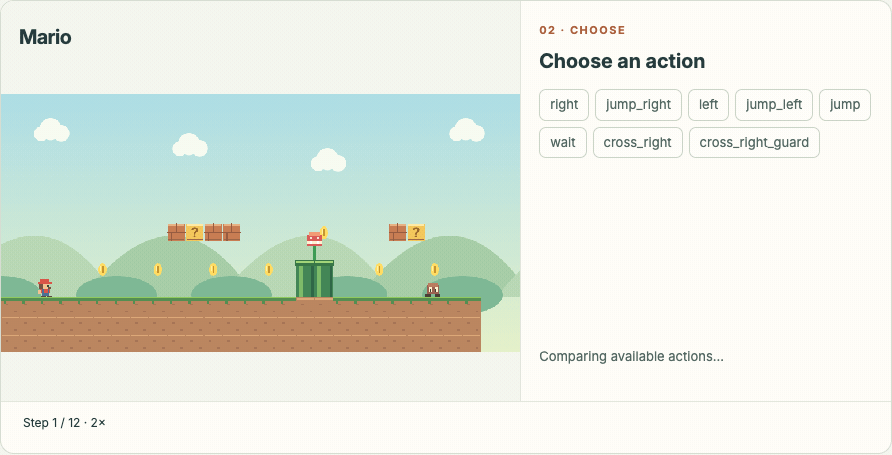</a></td>
    <td width="50%" align="center"><a href="arena/web/showcase/traces/snake.json">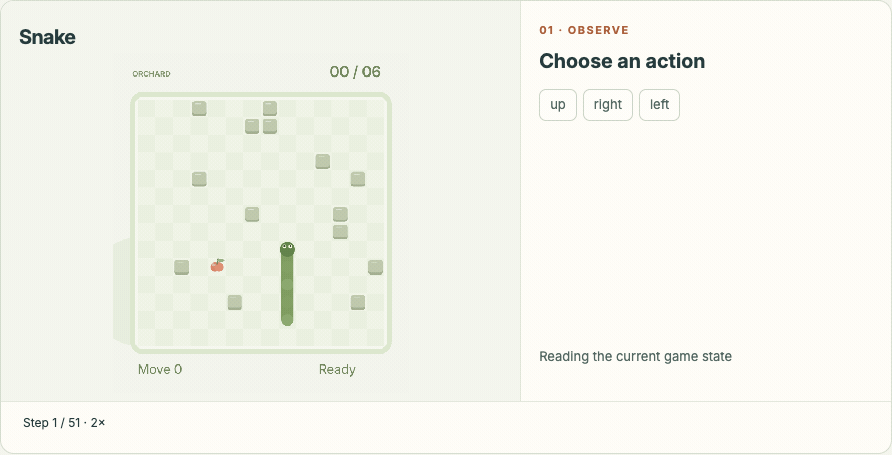</a></td>
  </tr>
  <tr>
    <td width="50%" align="center"><a href="arena/web/playground/data/home-decision.json">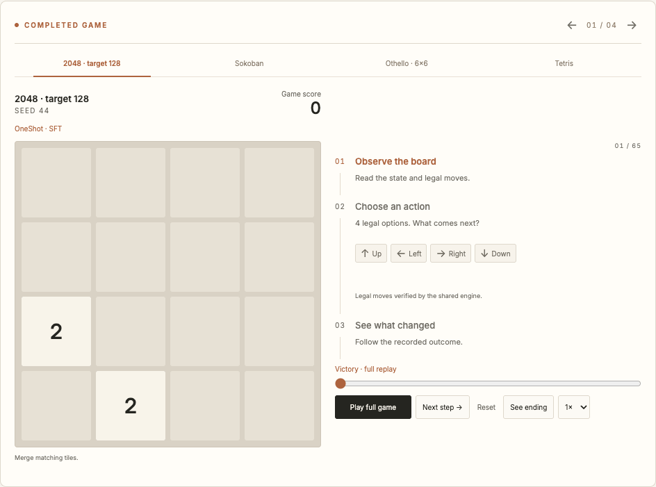</a></td>
    <td width="50%" align="center"><a href="arena/web/playground/data/home-decision.json">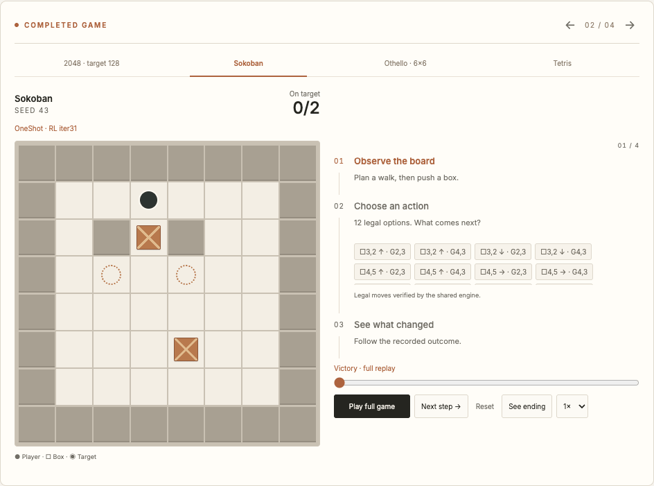</a></td>
  </tr>
  <tr>
    <td width="50%" align="center"><a href="arena/web/playground/data/home-decision.json">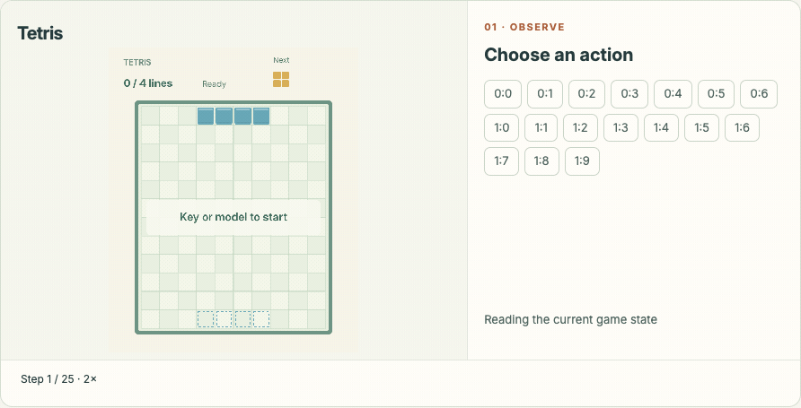</a></td>
    <td width="50%" align="center"><a href="arena/web/showcase/traces/jump-jump.json">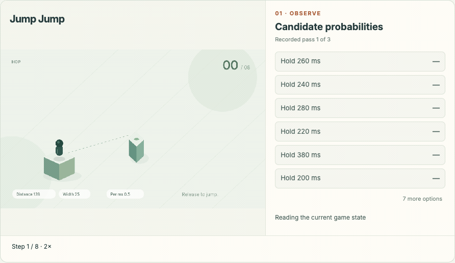</a></td>
  </tr>
  <tr>
    <td width="50%" align="center"><a href="arena/web/showcase/traces/hex.json">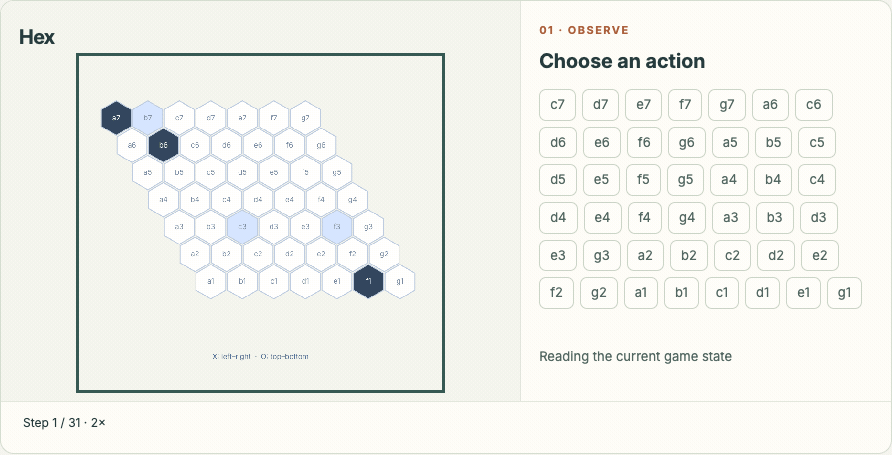</a></td>
    <td width="50%" align="center"><a href="arena/web/showcase/traces/dots-and-boxes.json">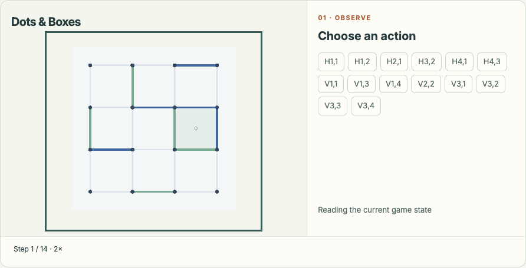</a></td>
  </tr>
  <tr>
    <td width="50%" align="center"><a href="arena/web/playground/data/home-decision.json">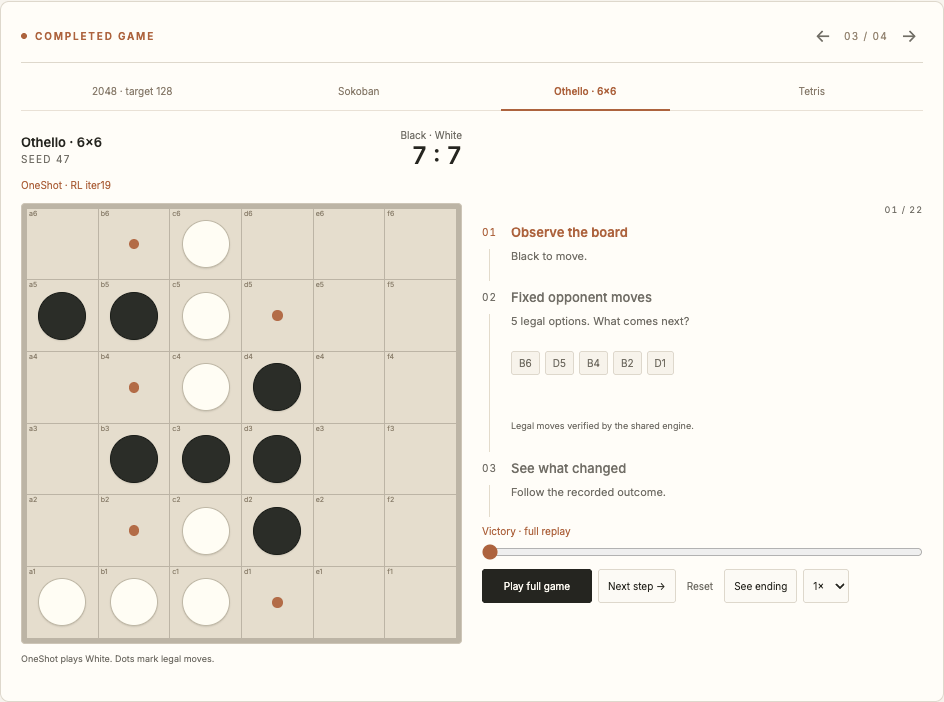</a></td>
    <td width="50%" align="center"><a href="https://decisionplayground.agentscope.io/blog/assets/zenless-zone-zero.mp4"></a></td>
  </tr>
</table>

These archived examples retain their original checkpoint identities and outcomes; they are separate from the benchmark table. GIF playback speed is not inference latency. [Showcase provenance and reproduction](docs/SHOWCASE.md).

## Local decision models in QwenPaw

Piccolo is integrated into **[QwenPaw main](https://github.com/agentscope-ai/QwenPaw/blob/main/docs/local-piccolo.md)**. Follow the [setup guide](docs/QWENPAW.md) to install QwenPaw from source and its **Piccolo-compatible llama.cpp runtime**.

1. In **Models → QwenPaw Local → Decision models**, download a Piccolo BF16 or Q8_0 GGUF, then click **Start**. Confirm **Models → Default models → Decision model**. Published Q4_K_M models can also be downloaded by repository ID.

   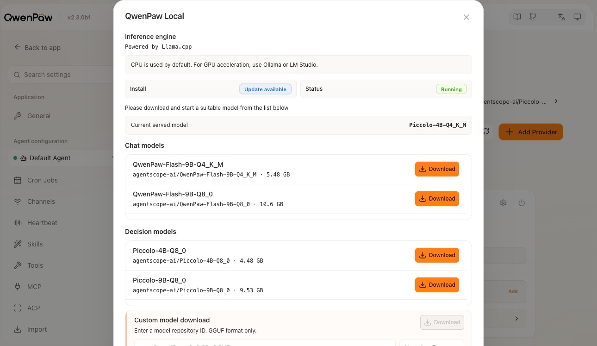

2. For automatic review, enable **Use decision model** in the conversation's model menu and select **Decision Model Mode** in tool approval settings.

   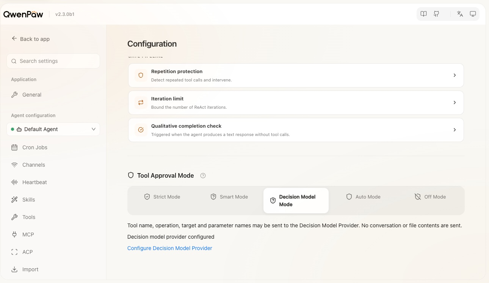

3. For context compaction, enable **Context Compaction**, then its separate **Decision Model Compaction** switch.

   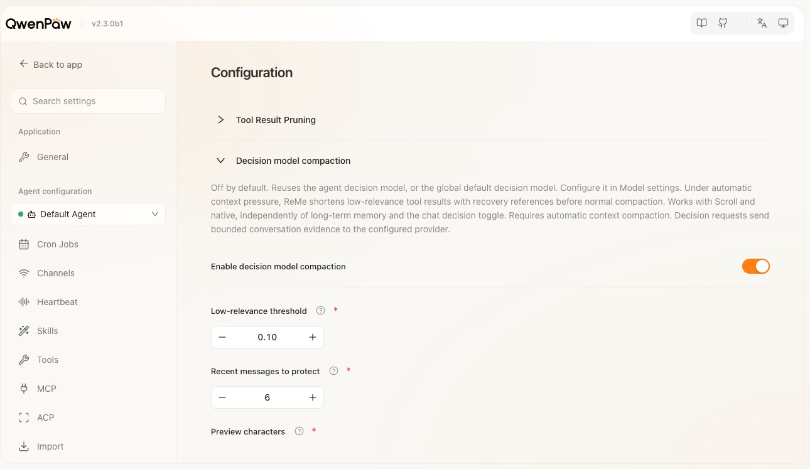

[Watch the payout audit in QwenPaw](https://decisionplayground.agentscope.io/piccolo.html#qwenpaw-showcase). Piccolo automatically approves two Bash reads and flags an attempted overwrite as destructive. The operator denies the write, leaving the original report intact.

Starting the model does not enable these features. The managed local runtime serves **one model at a time**; chat can use another provider. Review keeps its native thresholds and human-approval fallback. [Setup screenshots](assets/qwenpaw/README.md).

Piccolo reads candidate-token logits directly with bidirectional prompt attention in full-attention layers and unchanged linear attention. It generates no answer text. The native `/v1/systemone` endpoint returns structured results. Stock causal chat completion does not implement this contract. [Reference inference and request example](inference/README.md).

## Run the Arena

The complete blog video uses Git LFS; run `git lfs pull` after cloning. Source archives from Actions include all media.

For a static preview, Python 3 is sufficient:

```bash
python3 -m http.server 8080 --bind 127.0.0.1 --directory arena/web
```

Open **http://127.0.0.1:8080/completed-showcase.html** or **http://127.0.0.1:8080/showcase.html**. For the complete Arena, stop the preview server and use Python 3.12 and Node.js 22:

```bash
cd arena
python3.12 -m venv .venv
.venv/bin/python -m pip install -e .
bash scripts/run.sh
```

Open **http://127.0.0.1:8080/**. See [Arena setup](arena/README.md), [API](arena/docs/API.md) and [shared engines](arena/docs/ENGINE.md).

## Repository map

| Path | Contents |
| --- | --- |
| [models/](models/README.md) | Published model links and fixed revision manifest |
| [inference/](inference/README.md) | Full-checkpoint reference inference and native protocol |
| [examples/](examples/README.md) | Minimal decision request and local invocation |
| [evaluation/](evaluation/README.md) | Benchmark results and one-command reproduction |
| [arena/](arena/README.md) | Interactive application, shared engines, results and replays |
| [arena/docs/WEBSITE.md](arena/docs/WEBSITE.md) | Bilingual website source, Method figures and local preview |
| [examples/workflows/](examples/workflows/README.md) | 12 bilingual Harness and Data workflow examples |
| [docs/piccolo-blog.md](docs/piccolo-blog.md) | Launch article used for social publishing |

## Reproduce and contribute

```bash
cd arena
python3.12 scripts/export_home_decision.py --check
python3.12 -m unittest tests.test_home_decision -v
```

[Showcase notes](docs/SHOWCASE.md) explain asset generation. For issues, include the game, seed, reproduction steps and an anonymized replay where possible. Preserve original participant IDs and outcomes. See [verification](docs/VERIFICATION.md) and the [changelog](CHANGELOG.md).

## License and attribution

Original project code is licensed under **[Apache-2.0](LICENSE)**. The published model repositories also use Apache-2.0. Third-party components retain their own licenses: see [NOTICE](NOTICE), [Arena third-party notes](arena/docs/THIRD_PARTY.md) and [FlexDM's MIT notice](inference/reference/THIRD_PARTY_LICENSES.md). Arena derives from JevArena; historical `jev.*` protocols, `JEV_*` environment variables and replay IDs remain intact.
