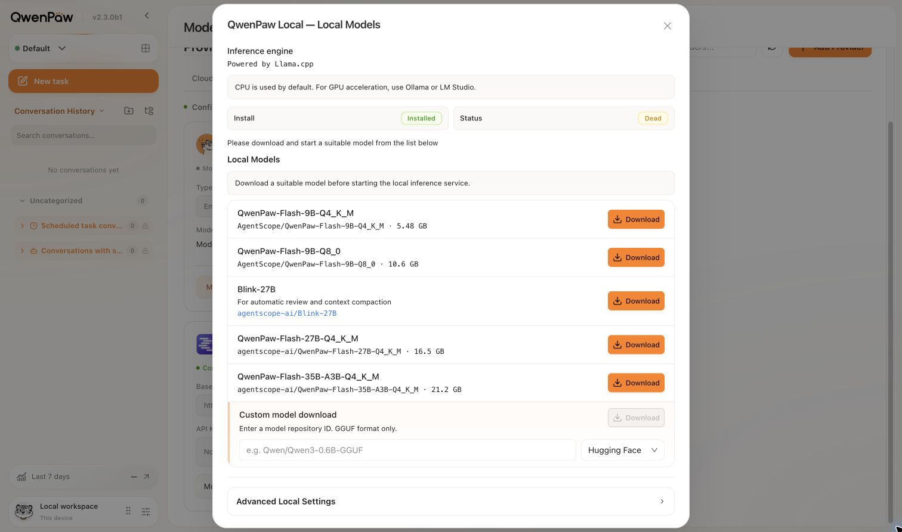
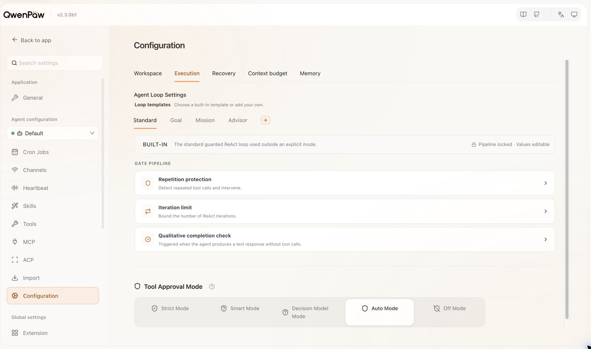
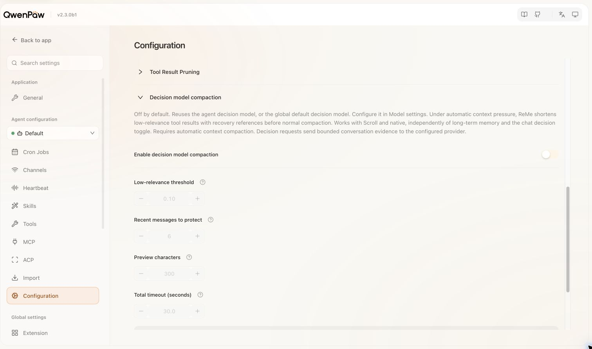

<p align="center"></p>

<h1 align="center">Piccolo</h1>
<p align="center"><strong>Fast, focused decisions for agent workflows.</strong></p>
<p align="center">
  <a href="https://decisionplayground.agentscope.io/">🌐 Decision</a> ·
  <a href="https://github.com/agentscope-ai/Piccolo"> GitHub</a> ·
  <a href="https://huggingface.co/agentscope-ai/Piccolo-27B"> Hugging Face</a> ·
  <a href="https://modelscope.cn/models/agentscope-ai/Piccolo-27B"> ModelScope · coming soon</a>
</p>
<p align="center">English / <a href="README_zh.md">简体中文</a> · <a href="docs/piccolo-blog.md">Launch blog 中文</a> · <a href="docs/MODELS.md">Model guide</a> · <a href="LICENSE">Apache-2.0</a></p>

Piccolo is a family of **4B, 9B and 27B decision models**. Given a state, a question and candidate options, it returns structured decisions and candidate probabilities for tool review, context retention, data workflows and interactive environments. **Piccolo-27B scores 92.21% on JevBench Public and 68.29 on Decision Index Public.** Try the [Decision website](https://decisionplayground.agentscope.io/) or run Piccolo locally through QwenPaw.

## Models

All **12 Hugging Face repositories are published** under Apache-2.0:

| Model | Complete Safetensors | BF16 GGUF | Q8_0 GGUF | Q4_K_M GGUF |
| --- | --- | --- | --- | --- |
| Piccolo-4B | [HF](https://huggingface.co/agentscope-ai/Piccolo-4B) | [BF16](https://huggingface.co/agentscope-ai/Piccolo-4B-BF16) | [Q8_0](https://huggingface.co/agentscope-ai/Piccolo-4B-Q8_0) | [Q4_K_M](https://huggingface.co/agentscope-ai/Piccolo-4B-Q4_K_M) |
| Piccolo-9B | [HF](https://huggingface.co/agentscope-ai/Piccolo-9B) | [BF16](https://huggingface.co/agentscope-ai/Piccolo-9B-BF16) | [Q8_0](https://huggingface.co/agentscope-ai/Piccolo-9B-Q8_0) | [Q4_K_M](https://huggingface.co/agentscope-ai/Piccolo-9B-Q4_K_M) |
| Piccolo-27B | [HF](https://huggingface.co/agentscope-ai/Piccolo-27B) | [BF16](https://huggingface.co/agentscope-ai/Piccolo-27B-BF16) | [Q8_0](https://huggingface.co/agentscope-ai/Piccolo-27B-Q8_0) | [Q4_K_M](https://huggingface.co/agentscope-ai/Piccolo-27B-Q4_K_M) |

The `-BF16` GGUFs are converted directly from the complete checkpoints; some normalization and recurrent-state tensors remain F32. Q8_0 and Q4_K_M trade size for numerical precision. Download **every GGUF shard** into one directory. [Model guide, immutable revisions and limitations](docs/MODELS.md).

[ModelScope / Piccolo-27B](https://modelscope.cn/models/agentscope-ai/Piccolo-27B) is the planned mirror and is **not published yet**. Use Hugging Face for downloads today.

## Evaluation

| Model | HarnessJevBench Hard ↑ | DataJevBench ↑ | JevBench Public ↑ | Decision Index Public ↑ |
| --- | ---: | ---: | ---: | ---: |
| **Piccolo-27B** | **82.03%** | **82.40%** | **92.21%** | **68.29** |
| Piccolo-9B | 69.49% | 68.80% | 89.61% | 60.63 |
| Piccolo-4B | 65.59% | 69.60% | 87.01% | 57.31 |

These results correspond to the currently published full Hugging Face checkpoints. Quantized variants have separate numerical regressions; these scores are not remeasured Q4/Q8 benchmark results. [Evaluation scope and source snapshots](evaluation/README.md) · [Live leaderboard](https://decisionplayground.agentscope.io/).

## How Piccolo learns

Training turns model improvement into a data iteration loop: **diagnose → select and construct data → train and evaluate → update the next recipe**. Multi-source material is organized into state/question/candidates/target distributions. Semantic slices and per-example learning signals help the agent identify useful supervision, revise data mixtures and compare experiments. Training and inference share the candidate interface, bidirectional prompt attention and the FlexDM-derived `flex_twice` layout. Read the [launch blog](docs/piccolo-blog.md) for the data engineering method and applications.

## See decisions unfold

Eight archived full replays show successive actions and recorded candidate probabilities. Interactive players support pausing, seeking and inspecting each decision.

<table>
  <tr>
    <td width="50%" align="center"><a href="arena/web/showcase/traces/mario.json"></a></td>
    <td width="50%" align="center"><a href="arena/web/showcase/traces/snake.json"></a></td>
  </tr>
  <tr>
    <td width="50%" align="center"><a href="arena/web/playground/data/home-decision.json"></a></td>
    <td width="50%" align="center"><a href="arena/web/playground/data/home-decision.json"></a></td>
  </tr>
  <tr>
    <td width="50%" align="center"><a href="arena/web/playground/data/home-decision.json"></a></td>
    <td width="50%" align="center"><a href="arena/web/showcase/traces/jump-jump.json"></a></td>
  </tr>
  <tr>
    <td width="50%" align="center"><a href="arena/web/showcase/traces/hex.json"></a></td>
    <td width="50%" align="center"><a href="arena/web/showcase/traces/dots-and-boxes.json"></a></td>
  </tr>
</table>

These archived examples retain their original checkpoint identities and outcomes; they are separate from the benchmark table. GIF playback speed is not inference latency. [Showcase provenance and reproduction](docs/SHOWCASE.md).

## Local decision models in QwenPaw

The native integration is available in **[Draft PR #8463](https://github.com/agentscope-ai/QwenPaw/pull/8463)** and requires its **Piccolo-compatible llama.cpp runtime**. Follow the [setup guide](docs/QWENPAW.md) before using the download controls; this is not yet a feature of every released QwenPaw build.

1. In **Models → QwenPaw Local → Decision models**, download a Piccolo BF16 or Q8_0 GGUF, then click **Start**. Confirm **Models → Default models → Decision model**. Published Q4_K_M models can also be downloaded by repository ID.

   

2. For automatic review, enable **Use decision model** in the conversation's model menu and select **Decision Model Mode** in tool approval settings.

   

3. For context compaction, enable **Context Compaction**, then its separate **Decision Model Compaction** switch.

   

Starting the model does not enable these features. The managed local runtime serves **one model at a time**; chat can use another provider. Review keeps its native thresholds and human-approval fallback. [English and Chinese full-screen screenshots](assets/qwenpaw/README.md).

Piccolo reads candidate-token logits directly with bidirectional prompt attention in full-attention layers and unchanged linear attention. It generates no answer text. The native `/v1/systemone` endpoint returns structured results. Stock causal chat completion does not implement this contract. [Reference inference and request example](inference/README.md).

## Run the Arena

For a static preview, Python 3 is sufficient:

```bash
python3 -m http.server 8080 --bind 127.0.0.1 --directory arena/web
```

Open **http://127.0.0.1:8080/completed-showcase.html** or **http://127.0.0.1:8080/showcase.html**. For the complete Arena, stop the preview server and use Python 3.12 and Node.js 22:

```bash
cd arena
python3.12 -m venv .venv
.venv/bin/python -m pip install -e .
bash scripts/run.sh
```

Open **http://127.0.0.1:8080/**. See [Arena setup](arena/README.md), [API](arena/docs/API.md) and [shared engines](arena/docs/ENGINE.md).

## Repository map

| Path | Contents |
| --- | --- |
| [models/](models/README.md) | Published model links and fixed revision manifest |
| [inference/](inference/README.md) | Full-checkpoint reference inference and native protocol |
| [examples/](examples/README.md) | Minimal decision request and local invocation |
| [evaluation/](evaluation/README.md) | Released-checkpoint scores and evidence scope |
| [arena/](arena/README.md) | Interactive application, shared engines, results and replays |
| [docs/piccolo-blog.md](docs/piccolo-blog.md) | Launch article used for social publishing |
| [training/](training/README.md), [data/](data/README.md) | Coming soon: training recipes and dataset release |

## Reproduce and contribute

```bash
cd arena
python3.12 scripts/export_home_decision.py --check
python3.12 -m unittest tests.test_home_decision -v
```

[Showcase notes](docs/SHOWCASE.md) explain asset generation. For issues, include the game, seed, reproduction steps and an anonymized replay where possible. Preserve original participant IDs and outcomes. See [verification](docs/VERIFICATION.md) and the [changelog](CHANGELOG.md).

## License and attribution

Original project code is licensed under **[Apache-2.0](LICENSE)**. The published model repositories also use Apache-2.0. Third-party components retain their own licenses: see [NOTICE](NOTICE), [Arena third-party notes](arena/docs/THIRD_PARTY.md) and [FlexDM's MIT notice](inference/reference/THIRD_PARTY_LICENSES.md). Arena derives from JevArena; historical `jev.*` protocols, `JEV_*` environment variables and replay IDs remain intact.
