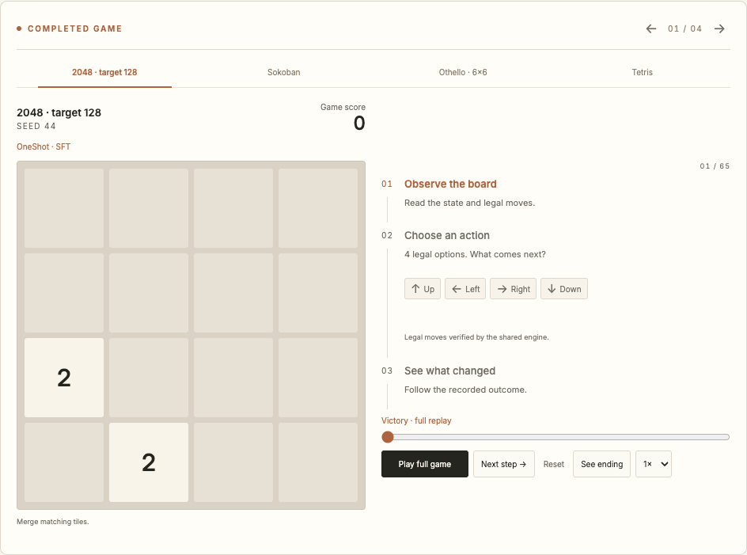
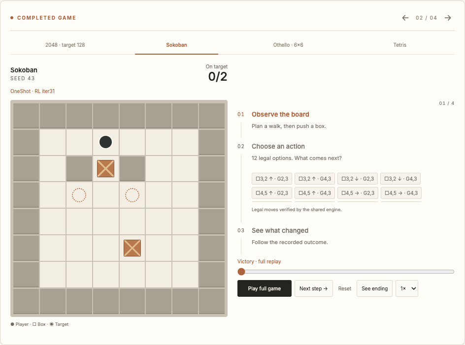
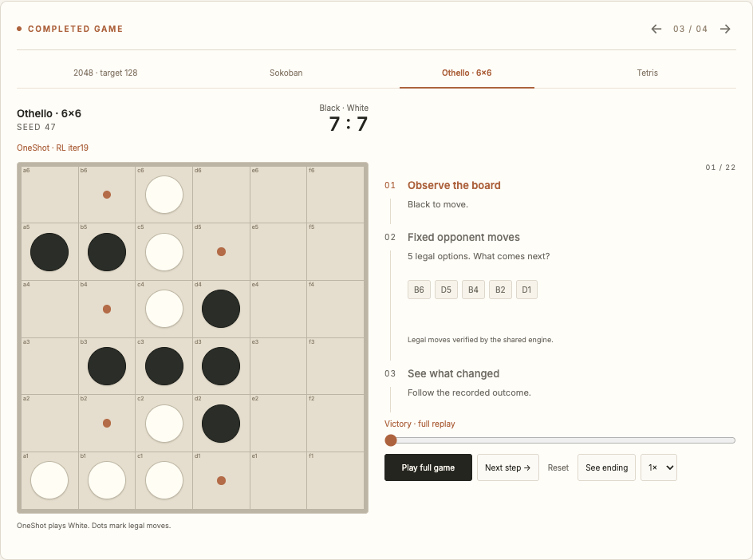
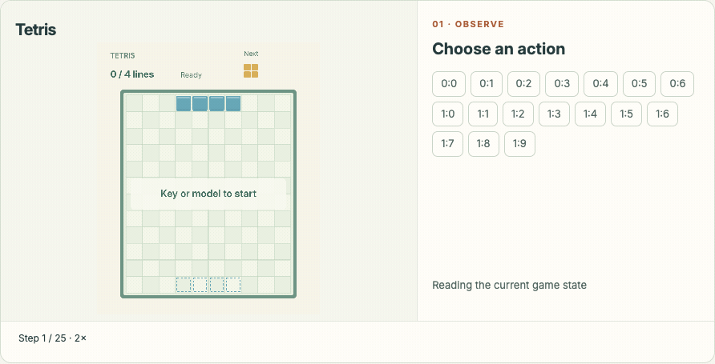

<p align="center"></p>

<h1 align="center">Blink</h1>
<p align="center"><strong>Decisions, in motion.</strong></p>
<p align="center"><a href="https://decisionplayground.agentscope.io/">Decision · Website</a> · English / <a href="README_zh.md">简体中文</a> · <a href="docs/blog.md">Blog 中文</a> · <a href="arena/README.md">Arena docs</a></p>

Blink connects **observation, action, and feedback** in an inspectable decision loop. Its Arena brings together interactive games, shared environment rules, model evaluation, and replayable trajectories. Explore the [Decision website](https://decisionplayground.agentscope.io/), or run the included Arena locally.

**Release status:** Arena code, historical replays, and the safety review integration scaffold are included. Blink model weights, a model card, dedicated inference and training recipes, and release evaluation are **coming soon**. Historical checkpoint names identify the recorded experiments; they are not the identity or results of a forthcoming Blink release.

## See decisions unfold

Four complete historical games, imported from JevArena's showcase. The interactive player exposes observations, candidate actions, recorded choices, and outcomes, with seeking, playback speed, and a jump-to-ending control.

| 2048 · reach the task's target of 128 | Sokoban · put both boxes on target |
| --- | --- |
| [](arena/web/playground/data/home-decision.json) | [](arena/web/playground/data/home-decision.json) |
| **Othello · finish a 6×6 game** | **Tetris · clear four lines** |
| [](arena/web/playground/data/home-decision.json) | [](arena/web/playground/data/home-decision.json) |

These are **selected successful episodes**, not an aggregate success rate or a model comparison. The four clips contain 116 recorded transitions and 89 model calls; opponent turns and automatic execution are labeled separately. GIFs sample saved states at a fixed pace, so their speed is not inference latency. The full player retains every recorded step and Tetris execution frames. [Provenance and reproduction](docs/SHOWCASE.md) explain each checkpoint, seed, outcome, and sampling rule. [Earlier examples](arena/web/showcase/manifest.json), including a failed Tetris run, remain available.

## Try it

### Preview the showcase

Python 3 is sufficient for this static, read-only preview:

```bash
python3 -m http.server 8080 --bind 127.0.0.1 --directory arena/web
```

Open **http://127.0.0.1:8080/completed-showcase.html**. No model, API key, or backend service is needed. Stop this server before starting Arena on the same port.

### Run Blink Arena

Use Python 3.12 and Node.js 22:

```bash
cd arena
python3.12 -m venv .venv
.venv/bin/python -m pip install -e .
bash scripts/run.sh
```

Open **http://127.0.0.1:8080/** to play manually, browse imported benchmark results, and inspect replays. A model service is optional. To connect one, use the model connection form and the [API contract](arena/docs/API.md); the service must allow the browser origin through CORS. See [Arena setup](arena/README.md), [shared engines](arena/docs/ENGINE.md), and [rollout API](arena/docs/ROLLOUT.md) for integration details.

## What's included

| Component | Available now | Next release |
| --- | --- | --- |
| Arena | Frontend, HTTP API, shared game engines, archived results and replays | See [Arena docs](arena/README.md) for supported behavior |
| Model | Historical identities remain attached to their replays | [Model card, weights and terms](models/README.md) |
| Inference | Arena can connect to an existing compatible service | [Blink model serving recipe](inference/README.md) |
| Training and data | Shared environment and rollout interfaces | [Training recipe](training/README.md), [data release](data/README.md) |
| Evaluation | Existing Arena evaluation code and historical result files | [Release-specific settings and results](evaluation/README.md) |
| Examples | Manual play, replay inspection, safety review scaffold | [End-to-end Blink model examples](examples/README.md) |

A placeholder directory documents planned work; it does not contain an executable implementation.

## Action safety review

The [blink-safety-review skill](skills/blink-safety-review/SKILL.md) includes a release download helper, decision client, and optional QwenPaw ToolGuard adapter for `allow`, `ask_user`, or `deny` advice on a proposed tool action.

The [release descriptor](skills/blink-safety-review/assets/release.json) is deliberately unconfigured. No model is downloaded or activated by default, and model-backed action review has not been validated by the game showcase. Follow the [QwenPaw integration guide](skills/blink-safety-review/references/qwenpaw.md) once the model release and serving adapter are available.

## Repository map

```text
arena/                      Standalone Arena application, engines and archives
assets/showcase/             Reproducible GIFs, posters and frame manifests
docs/                       Blog, provenance, release scope and verification
scripts/                    Showcase rendering and frontend verification
skills/blink-safety-review/  Action review integration scaffold
models/                     Coming soon: model card, weights and release terms
inference/                  Coming soon: Blink inference and serving
training/                   Coming soon: training recipes and configuration
data/                       Coming soon: dataset documentation and release
evaluation/                 Coming soon: release evaluation and results
examples/                   Coming soon: Blink model integration examples
```

## Reproduce and contribute

The complete replay archive can be checked offline using Python 3.12, without a model:

```bash
cd arena
python3.12 scripts/export_home_decision.py --check
python3.12 -m unittest tests.test_home_decision -v
```

To rebuild images, install Playwright, its Chromium browser, and `ffmpeg`, then run `python scripts/render_completed_showcase.py` from the repository root. [Showcase notes](docs/SHOWCASE.md) also cover the earlier asset set.

For a useful issue or contribution, include the game, seed, steps to reproduce, and an anonymized replay when available. Keep original participant IDs and outcomes intact. See [verification](docs/VERIFICATION.md) for tested scope and known limitations, and [repository notes](docs/REPOSITORY.md) for remaining release work.

## Attribution and licensing

Arena and the completed showcase were adapted from JevArena. Historical `jev.*` protocols, `JEV_*` environment variables, and checkpoint IDs remain compatible. Component origins, game libraries, fonts, and existing licenses are listed in [third-party notes](arena/docs/THIRD_PARTY.md). A project-wide code license and model-weight terms are still pending; this repository does not yet grant a new project-wide license.
