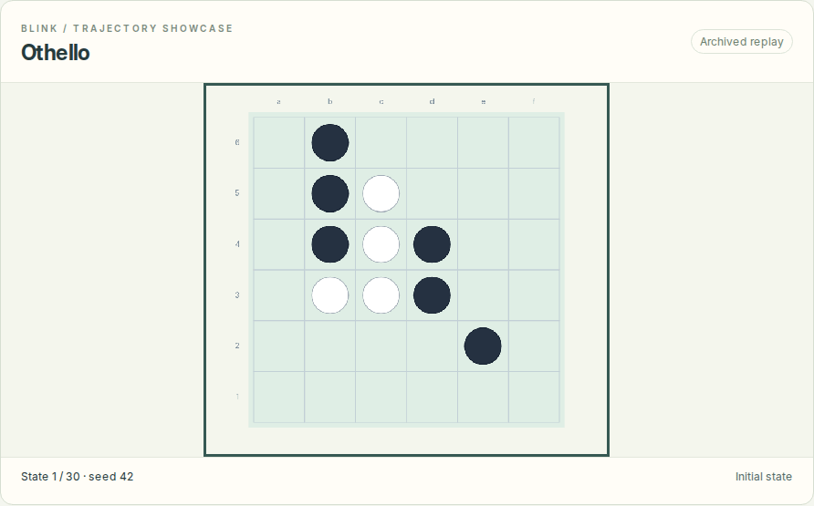
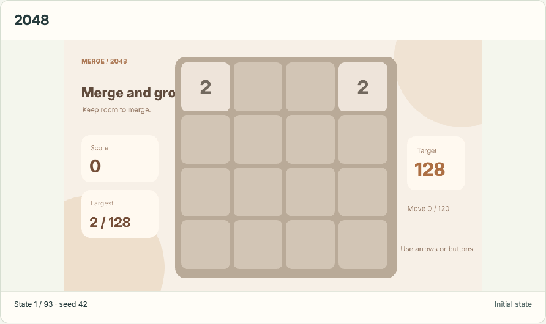
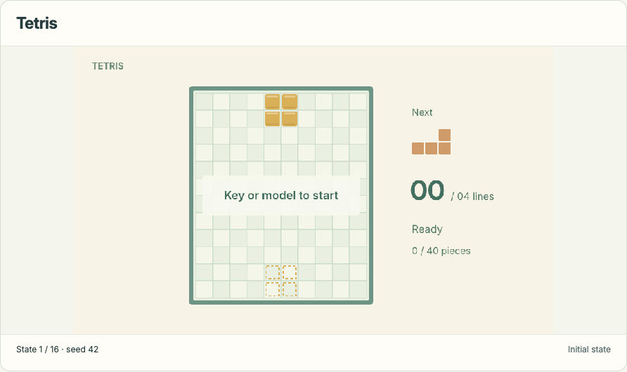

<p align="center"></p>

<h1 align="center">Blink</h1>
<p align="center"><strong>让决策动起来。</strong></p>
<p align="center"><a href="README.md">English</a> · 简体中文 · <a href="arena/README.md">Blink Arena</a> · <a href="docs/SHOWCASE.md">轨迹来源</a> · <a href="skills/blink-safety-review/SKILL.md">安全审批 Skill</a></p>

Blink 汇集交互试玩、共享游戏引擎与可检查的决策轨迹。**模型尚未确定**，当前不提供权重、模型推理或训练实现；`inference/` 和 `training/` 仅保留空目录占位。

## Showcase

下列动图来自前端已经保存的历史轨迹，由原有游戏渲染器生成。它们用于展示交互与回放能力，**不代表待发布 Blink 模型的成绩**。动画按固定节奏展示归档决策状态，并非原始实时录像。

| 黑白棋 · 回合决策 | 2048 · 合并与空间选择 |
| --- | --- |
| [](arena/web/showcase/traces/othello.json) | [](arena/web/showcase/traces/merge-2048.json) |
| **跳一跳 · 落点选择** | **俄罗斯方块 · 落子过程，保留失败结果** |
| [](arena/web/showcase/traces/jump-jump.json) | [](arena/web/showcase/traces/tetris.json) |

点击动图可查看原始轨迹。源记录、参与者 ID、录制类型和终局结果保存在 [来源清单](arena/web/showcase/manifest.json)；采样及复现方式见 [Showcase 说明](docs/SHOWCASE.md)。

## 本机启动

需要 Python 3.12、Node.js 22。浏览历史成绩、回放和手动试玩不需要模型。

```bash
cd arena
python3.12 -m venv .venv
.venv/bin/python -m pip install -e .
bash scripts/run.sh
```

试玩入口：**http://127.0.0.1:8080/**。轨迹展示：**http://127.0.0.1:8080/showcase.html**。

已有模型服务可通过页面的模型连接表单接入，协议见 [API 文档](arena/docs/API.md)。前端、HTTP 服务、共享规则和归档结果一起放在 `arena/` 中。历史模型 ID、轨迹 ID、`jev.*` 协议与 `JEV_*` 环境变量保持兼容；对外品牌统一为 Blink / Blink Arena，第三方 benchmark 保留原名。

## QwenPaw 安全审批 Skill

[blink-safety-review](skills/blink-safety-review/SKILL.md) 包含模型下载助手、动作审查客户端和可选 ToolGuard 适配器。目标流程是：下载指定 Blink 发布版本 → 启动该版本的本地服务 → 将用户意图与待执行工具动作交给模型审查。

审查建议分为 `allow`、`ask_user`、`deny`。模型、版本及自动放行阈值未配置时不自动放行；Skill 不执行被审查的动作，不代替用户点击批准，也不覆盖 QwenPaw 原有规则。

当前发布清单为空，尚未下载或启用真实审批模型。导入 Skill 与接入宿主 ToolGuard 是两个步骤，见 [QwenPaw 接入说明](skills/blink-safety-review/references/qwenpaw.md)。

## 目录

```text
arena/                      Blink Arena 完整应用
assets/showcase/             动图、预览图及逐帧来源
docs/                       来源、整理范围与验证记录
scripts/                    从归档重新导出并渲染展示
skills/blink-safety-review/  安全审批 Skill
inference/                  空占位
training/                   空占位
```

重新生成 Showcase：安装 Playwright、Chromium 和 ffmpeg 后，在仓库根目录执行 `python scripts/export_showcase.py`、`python scripts/render_showcase.py`。脚本只启动临时回环资源服务，不调用模型，完成后关闭服务。

验证情况见 [验证记录](docs/VERIFICATION.md)。第三方代码、规则库与字体来源见 [第三方说明](arena/docs/THIRD_PARTY.md)。项目级代码许可与模型权重条款待确定，现有第三方声明保留。
