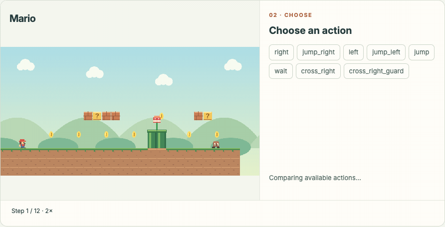
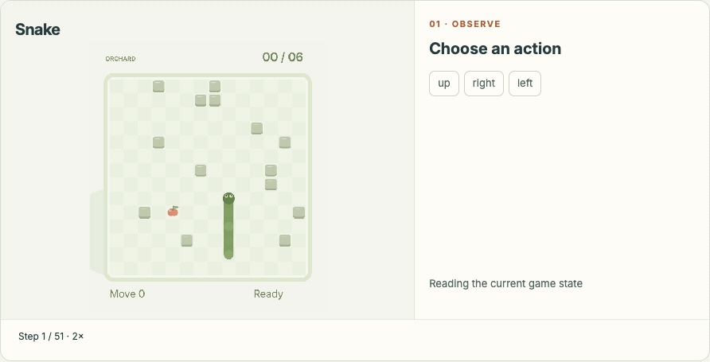
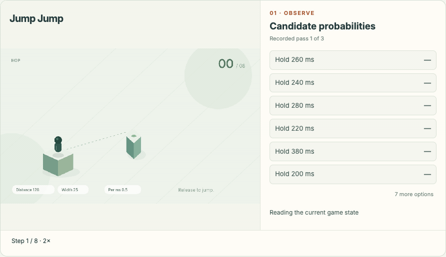
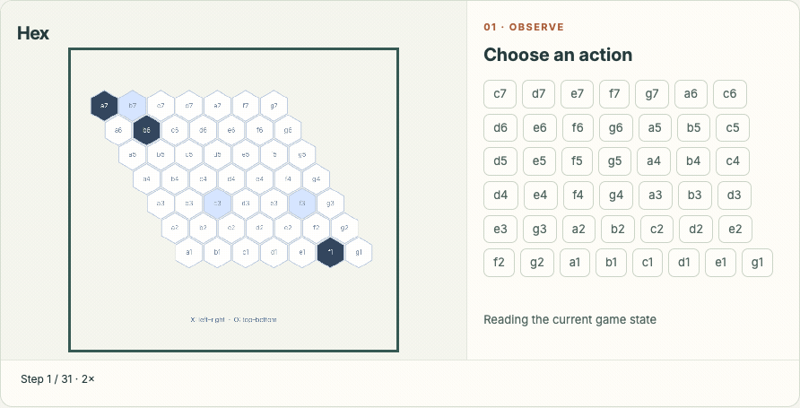
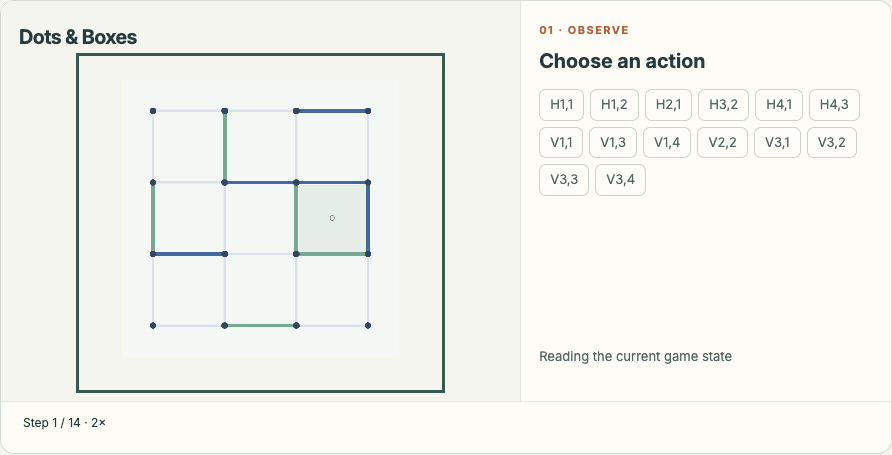
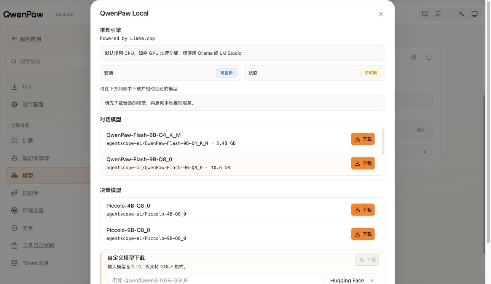
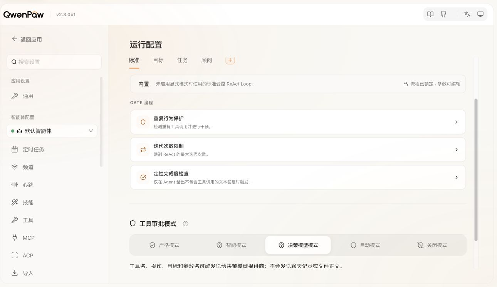
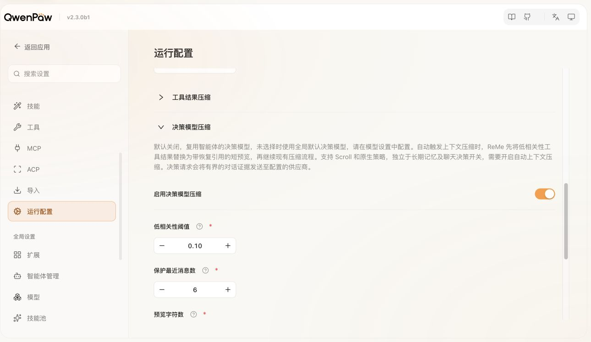

# Piccolo：为决策而生

下一步如何行动？这次工具调用能否执行？哪些上下文值得保留？

这些判断贯穿交互环境与智能体工作流：问题具体、调用频繁，结果需要直接用于执行。交给对话模型逐一处理，延迟和成本也随之累积。专为这类任务设计的决策模型，因此受到越来越多的关注。

我们带来 **Piccolo**，一个强大、快速、高性价比的决策模型。给定背景与候选项，它返回结构化结果和概率，供程序直接使用。从游戏中的连续决策，到智能体的工具审核与上下文筛选，Piccolo 已接入实际工作流。你可以在线体验、查看评测结果，也可以通过 QwenPaw 在本地运行。

- 🌐 **体验主页：**[Decision](https://decisionplayground.agentscope.io/)
- 💻 **项目仓库：**[Piccolo](https://github.com/agentscope-ai/Piccolo)
- 🐾 **本地接入：**[模型与 QwenPaw 使用说明](MODELS.md)

## 01 Showcase

移动、跳跃、落子。模型根据当前局面选择动作，环境随之变化，下一次判断由此开始。下面的八个完整回放，展示决策如何连续推动一局游戏；右侧呈现候选概率与最终选择。

<table>
  <tr>
    <td width="50%" align="center"></td>
    <td width="50%" align="center"></td>
  </tr>
  <tr>
    <td width="50%" align="center"></td>
    <td width="50%" align="center"></td>
  </tr>
  <tr>
    <td width="50%" align="center"></td>
    <td width="50%" align="center"></td>
  </tr>
  <tr>
    <td width="50%" align="center"></td>
    <td width="50%" align="center"></td>
  </tr>
</table>

[前往 Decision 体验 →](https://decisionplayground.agentscope.io/)

## 02 Auto-research

**TODO**

## 03 Leaderboard

Piccolo 27B 在 JevBench 上取得 **92.21%** 的准确率，在 Decision Index 上取得 **68.29** 分。

| 模型 | JevBench 准确率 ↑ | Decision Index ↑ |
| --- | ---: | ---: |
| **Piccolo 27B** | **92.21%** | **68.29 / 100** |

[查看完整榜单 →](https://decisionplayground.agentscope.io/)

## 04 QwenPaw：本地部署的决策模型 Piccolo

**工具审核和上下文筛选会随着智能体执行任务高频反复发生。** 这些判断的问题明确、输出简短，但有时伴随着隐私的信息，适合交给独立的本地决策模型处理。

**Piccolo 基于 QwenPaw 定制而生，将这类高频判断放到用户设备上，由用户按需调用。** 接入 Piccolo 后，主模型负责理解任务、规划步骤和生成内容；Piccolo 接收当前判断所需的背景与候选项，返回结构化结果和概率。例如，工具执行前判断操作风险，上下文压缩时判断哪些原文值得保留。Harness 再根据返回结果与预设规则，组织后续执行。

**本地部署让这部分辅助判断可以在本机完成，减少网络往返和对远端决策服务的依赖。用于判断的工具信息与历史片段也可以留在本地处理，减少额外的数据外发。** 主模型可以随着用户需求随时切换更加强大高效的模型，而决策服务则独立部署、配置和更新，两者解耦，最大化平衡性能、安全和 token 用量。

**Piccolo 的接入，可以让 QwenPaw 获得类似于原生 Codex 的自动审批能力**。对于工具审核，QwenPaw 可以结合 Piccolo 审批的结果和已有权限规则决定主模型的后续处理。这样，使用更为强大的模型判断接入实际工作流的时候，可以保留明确的执行边界。

**只需三步，快速启动你的 Piccolo：**

1. **从 QwenPaw Local 下载并安装中选择合适量级的 Piccolo**

   
2. **将工具审批模式改为决策模型模式**

   
3. **启用决策模型压缩上下文**

   

只需三步，在 QwenPaw 上获取快速又安全的自动审批体验。

**你担心的安全和性价比问题，都让 Piccolo 来解决吧！**

## 05 自研 Benchmark

**TODO**

## 关于 Piccolo

Piccolo 是 QwenPaw-Flash 的孪生模型，围绕**如何让模型在交互环境中做出可执行、可验证的决策**的需求进行设计。我们希望把交互环境建设成连接模型、执行与反馈的共同基础，让决策能被检查，并进一步成为评测和学习的依据。

欢迎从 [Decision 官网](https://decisionplayground.agentscope.io/) 开始体验，希望进一步了解 Piccolo 的读者，可以查看 [Piccolo](https://github.com/agentscope-ai/Piccolo)。

**TODO：**

1. **Piccolo 正式模型版本、下载入口（Hugging Face）、部署与接入命令、支持的硬件、内存或显存占用。**
2. **测试条件的单次／批量决策延迟、评测集性能。**

<!--
编辑核对信息，不进入发布正文：
- 2026-10-29 按用户新开头精简导语、Showcase 和榜单，保留 QwenPaw 给定原文。另阅读 Jev 官方发布文 https://typesafe.ai/blog/introducing-system-one-models-and-jev 及 https://typesafe.ai/blog/jev-1-14，仅参考表达节奏，不移用其技术或性能主张。
- 结构参考 StartLux 官方发布页 https://decision.startlux.com/、博客索引 https://www.startlux.com/blog/ 及官方仓库 https://github.com/StartLuxLabs/StartLux-Decision；独立博客页当前要求站点验证，未读取其完整正文，不引用其技术或性能结论。
- 官网数据核对于 2026-10-29：https://decisionplayground.agentscope.io/api/leaderboard。
- 表格同步 GitLab 提交 8b1d245 的公开榜单，model_id=blink-27b-1028，显示名称 Piccolo-27B。JevBench accuracy=0.922077922077922；Decision Index score=68.29。原始 model_id 保留用于核验；本次未重跑正式评测。
- TODO：发布前确认 Piccolo 发布权重与以上成绩的对应关系；本次未重新运行正式模型评测。按用户要求，正文采用 Piccolo 发布稿命名，不显示版本与评测口径说明。
- Showcase 复用 docs/SHOWCASE.md 所列的八条历史实验轨迹，不将精选展示用作总体成功率。游戏名称在画面中保留，图外不加标签；右侧候选项与完整动画沿用现有素材。
- QwenPaw 段落及“关于 Piccolo”沿用用户提供的文案，只替换模型显示名并整理 Markdown。代码仓库和下载资源实际路径仍使用 Blink，不虚构 Piccolo URL。
- 本地服务核对：/health 返回 ok，/v1/models 返回 agentscope-ai/Blink-4B-Q8_0；服务运行与模型身份不等于正式性能、延迟或安全评测结果。
-->
