# Piccolo: Fast Decisions for Agent Workflows

Today, we are releasing **Piccolo**, a family of decision models for agent workflows, available in **4B, 9B, and 27B** sizes. Piccolo-27B-VL ranked first on Decision Index Vision Full with a score of 75.59.

From tool review and context filtering for agents to critical decisions in data-processing environments and sequential judgments in games, Piccolo understands the current state, compares candidates, and returns results and probabilities that programs can use directly. We present its capabilities and practical uses through interactive demonstrations, evaluation results, and local integration.

  <a href="https://decisionplayground.agentscope.io/">🌐 Decision</a> ·
  <a href="https://github.com/agentscope-ai/Piccolo"> GitHub</a> ·
  <a href="https://huggingface.co/agentscope-ai/Piccolo-27B"> Hugging Face</a> ·
  <a href="https://www.modelscope.cn/models/AgentScope/Piccolo-27B"> ModelScope</a>

**Complete weights, BF16 GGUF, Q8_0, and Q4_K_M are available on Hugging Face and ModelScope** under Apache-2.0. [Choose and download a model](MODELS.md).

## 01 Demo Showcase

Move, jump, place a piece. The model selects an action based on the current situation, the environment changes, and the next judgment begins. Nine game replays demonstrate sequential decisions; scenes with probability records also show candidate distributions and final choices. A 95-second Zenless Zone Zero combat recording synchronizes key presses with character actions.

Two additional showcases come from agent and data workflows. One records QwenPaw tool approval; the other shows Piccolo's judgments on [DataJevBench](https://github.com/datajuicer/DataJevBench) samples.

<table>
  <tr>
    <td width="50%" align="center">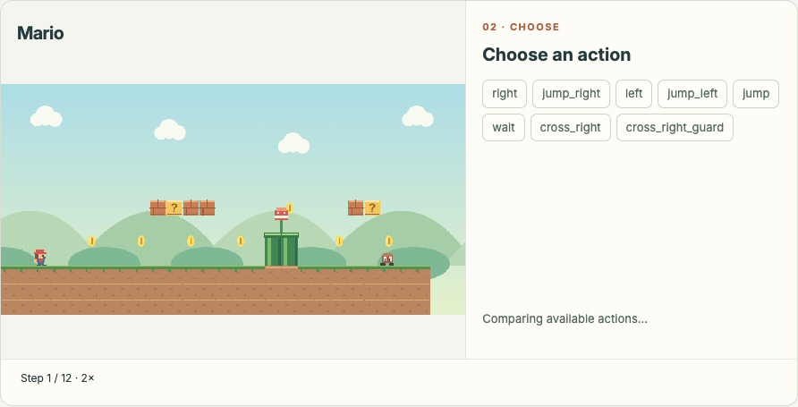</td>
    <td width="50%" align="center">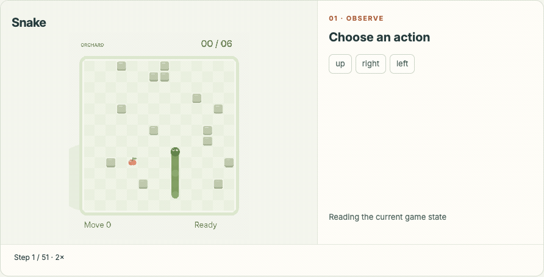</td>
  </tr>
  <tr>
    <td width="50%" align="center">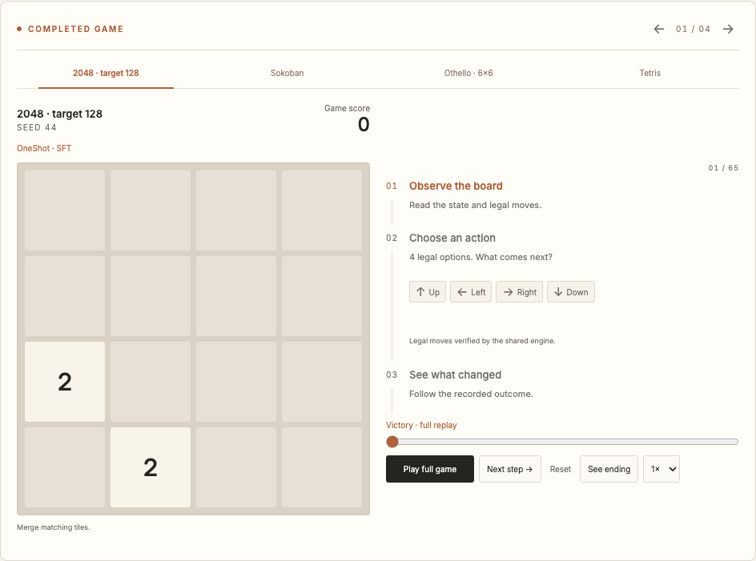</td>
    <td width="50%" align="center">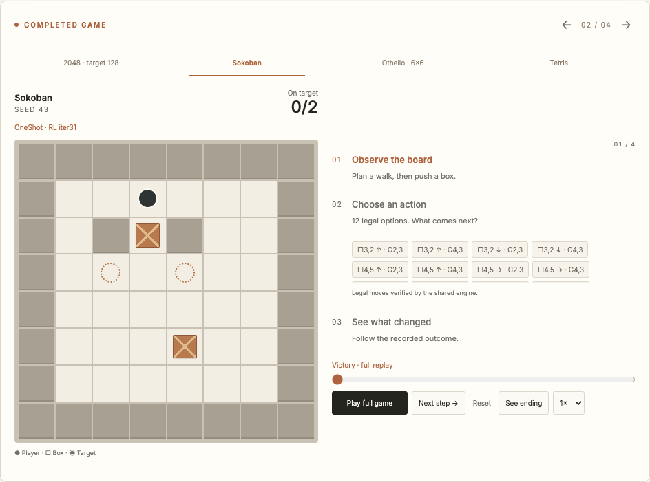</td>
  </tr>
  <tr>
    <td width="50%" align="center">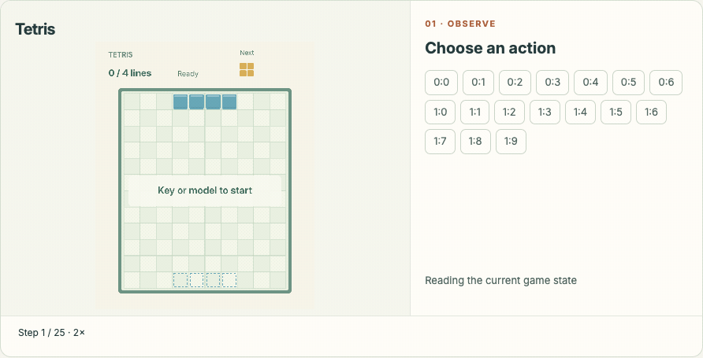</td>
    <td width="50%" align="center">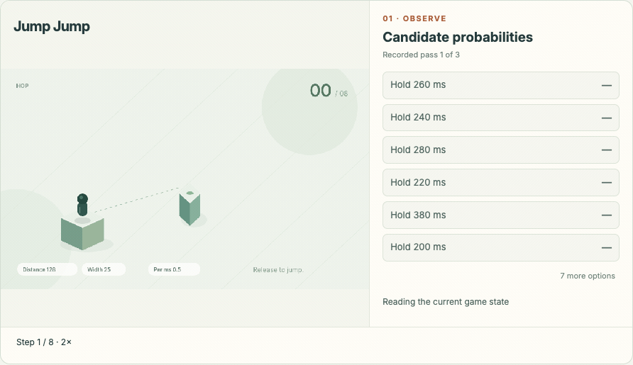</td>
  </tr>
  <tr>
    <td width="50%" align="center">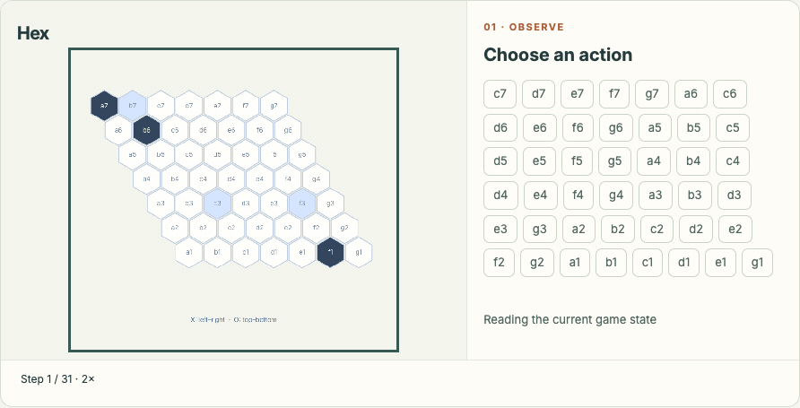</td>
    <td width="50%" align="center">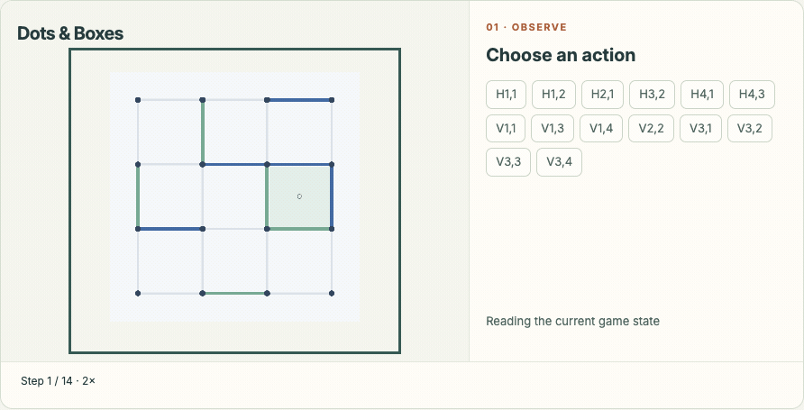</td>
  </tr>
  <tr>
    <td width="50%" align="center">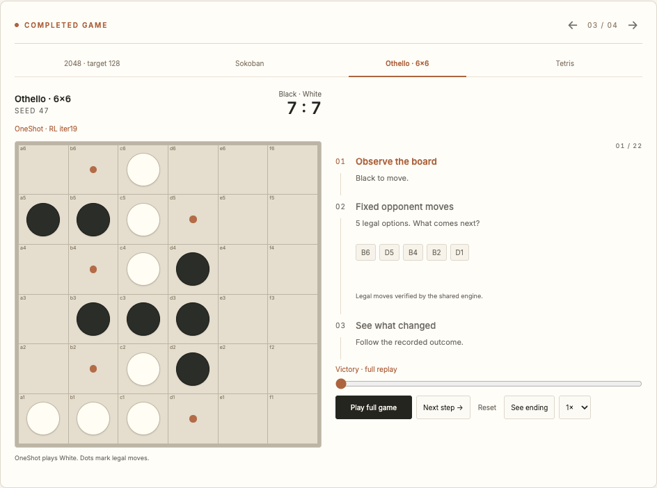</td>
    <td width="50%" align="center"></td>
  </tr>
  <tr>
    <td width="50%" align="center"></td>
    <td width="50%" align="center"></td>
  </tr>
</table>

[Try Decision →](https://decisionplayground.agentscope.io/)

Replays preserve their original experiment identities and outcomes. See [Showcase documentation](SHOWCASE.md) for sources. Animation pacing is for presentation and does not represent inference latency.

## 02 Evaluation: Three Sizes, Different Capability Options

The Vision scores below belong to the VL releases. Text and application results belong to the foundation releases.

| Model | Vision Full | Vision Public | Vision Private | Text Full | Text Public | JevBench-231 | HarnessJevBench Hard | DataJevBench |
| --- | ---: | ---: | ---: | ---: | ---: | ---: | ---: | ---: |
| **Piccolo-27B-VL** | **75.59** | **80.22** | **70.97** | — | — | — | — | — |
| Piccolo-9B-VL | 68.35 | 71.67 | 65.04 | — | — | — | — | — |
| Piccolo-4B-VL | 67.46 | 71.42 | 63.49 | — | — | — | — | — |
| Piccolo-27B | — | — | — | 68.40 | 68.08 | 92.21% | 84.41% | 82.60% |
| Piccolo-9B | — | — | — | 57.34 | 60.30 | 89.61% | 70.68% | 69.20% |
| Piccolo-4B | — | — | — | 50.00 | 57.14 | 87.01% | 63.22% | 71.20% |

Piccolo-27B scores highest among the three sizes on all four evaluations. The 9B and 4B models reach **89.61%** and **87.01%** on JevBench Public, offering more choices for resource-constrained deployments. [Evaluation results](../evaluation/README.md) · [Full online leaderboards](https://decisionplayground.agentscope.io/).

## 03 Training: Let Feedback Drive the Next Round of Data

**Piccolo training turns model optimization into an iterative search for good data: identify the supervision the current model needs, organize the relevant material, and use training feedback to update the next data recipe.** An agent uses this process to select data, design experiments, and compare results, building each training round on previous findings.

### From multiple sources to observable data slices

Training material is curated from **6.65 million raw source records**, covering classification, retrieval, mathematical and scientific reasoning, preference judgments, and tool use. Decision tasks are also constructed from state changes, action choices, and constraints in environments. Sources are unified into **“state, question, candidates, target distribution”**: hard labels express definite choices, while soft labels preserve scores, preferences, and disagreements.

Data governance addresses duplication, answer grounding, candidate distinctions, position bias, and training–evaluation overlap. Using the slicing capabilities of [Data-Juicer](https://github.com/datajuicer/data-juicer), the labeling scheme contains **13 annotation dimensions and 551 predefined values**, including **334 domain categories** and **144 capability labels**. Intersections of domain, capability, difficulty, and task format make recipe adjustments specific to concrete judgments.

**Connecting per-question learning signals with semantic labels reveals what the model is learning.** For soft labels, cross-entropy decomposes into target-distribution entropy and model divergence:

$$
\mathrm{CE}(y,p)=H(y)+\mathrm{KL}(y\Vert p).
$$

Rapidly declining slices help identify where learning is effective. Slices stable at low values inform replay and sampling adjustments; high-divergence or volatile slices prompt answer review, difficulty analysis, and targeted supplementation. Slices provide diagnostic clues, while subsequent training and evaluation test whether the adjustments work.

### Select data and methods within the experiment loop

Built on [Agentic Data Engineering](https://github.com/datajuicer/agentic-data-engineering), the process starts with humans setting goals, budgets, and data-use scope. The agent carries out **plan design → construction and experimentation → result feedback → diagnosis and updates**. DataJuicer-Panel connects data versions, parent models, training configurations, and experiment results, accumulating queryable lineage and experience. [DataJuicer-Sandbox](https://github.com/datajuicer/data-juicer-sandbox) executes data processing, training, and evaluation.

| Data action | Concrete operations |
| --- | --- |
| Removal and downsampling | Remove erroneous and duplicate material; adjust exposure to similar examples already learned sufficiently |
| Filtering and mixing | Combine background, targeted, and replay data by labels, semantic similarity, and learning status |
| Auditing and rewriting | Add missing conditions, correct answers, rebuild distractors, and adjust candidate positions |
| Targeted synthesis | Construct new questions around capability gaps, task mechanics, and difficulty, then verify them and obtain model trial answers |

These actions can be combined in a single plan. The agent compares overall and per-category changes to choose subsequent branches, retaining effective recipes and their conditions of use. The model, data, and experiment records together become the starting point for the next round.

### Use the same decision interface for training and inference

Piccolo learns judgments among candidates directly: candidate scores are read at the answer position, and training uses cross-entropy over candidate distributions. Inference uses the `flex_twice` input layout derived from [FlexDM](https://github.com/1000luca/FlexDM), applies **bidirectional prompt attention** in Qwen3.5's full-attention layers, and preserves the original computation in linear-attention layers. Single-token candidate logits are read and normalized into probabilities at temperature 1.

The model does not need to generate an explanation before a program extracts the answer. A structured interface turns candidate probabilities into selections, binary judgments, or ordinal scores for the Harness. Input templates, candidate mappings, and attention behavior stay consistent between training and inference. [Inference documentation](../inference/README.md).

## 04 QwenPaw: A Locally Deployed Decision Model

Tool review and context filtering recur throughout agent execution. The main conversation model understands the task, plans, and generates content. Piccolo receives the context and candidates needed for the current judgment and returns structured results and probabilities; the Harness then executes according to existing rules.

### Automatic review: Break operational risk into concrete questions

Before tool execution, QwenPaw uses `assess_tool_call()` to collect the tool name, operation type, target, parameter names, sandbox status, and existing risk signals, then asks the decision model four types of questions:

| Judgment dimension | Content |
| --- | --- |
| Operational impact | Read-only, routine change, high risk, or insufficient information |
| Data destruction | Could the operation delete or overwrite existing user data? |
| Sensitive information exposure | Could it read credentials or transmit sensitive information off the local machine? |
| Permission changes | Could it expand permissions or weaken security boundaries? |

The model returns classifications, probabilities, and confidence. The program uses fixed thresholds to decide whether to request human approval. Existing permission rules and manual-confirmation fallback remain in effect.

### Context compaction: Retain original text needed later

Tool results, logs, and code in long conversations can fill the context window. Summaries preserve the main discussion but may lose order numbers, error details, or specific values. The decision model asks, in the context of the current task, **“Will this tool result still be useful later?”**, helping compaction retain important original text alongside summaries.

The value of this judgment is to preserve evidence needed for the next step within a limited context, reducing repeated searches through history. Actual retention quality still depends on the task, thresholds, and context budget.

### Download, start, and use Jev's existing activation controls

Piccolo reuses QwenPaw-Flash's local GGUF download and runtime management, along with Jev's existing decision model configuration controls. No extra Skill or separate service URL is required. Local decision model integration is merged into **[QwenPaw main](https://github.com/agentscope-ai/QwenPaw/blob/main/docs/local-piccolo.md)**. Follow the [guide](QWENPAW.md) to install QwenPaw from official source and configure a Piccolo-compatible llama.cpp runtime.

1. **Download and start a decision model.** Choose a suitable BF16 or Q8_0 version under **Models → QwenPaw Local → Decision Models**. After downloading, click **Start**, then confirm under **Models → Default Models → Decision Model**. Q4_K_M can be downloaded through custom downloads using its Hugging Face repository ID.

   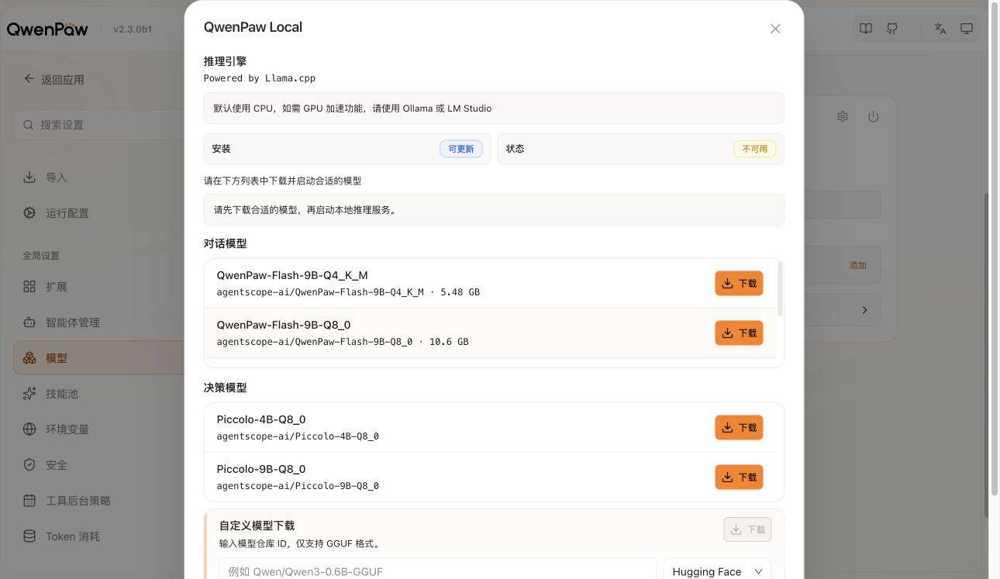

2. **Enable automatic review.** Open **Use Decision Model** in the conversation's model menu and set tool approval to **Decision Model Mode**.

   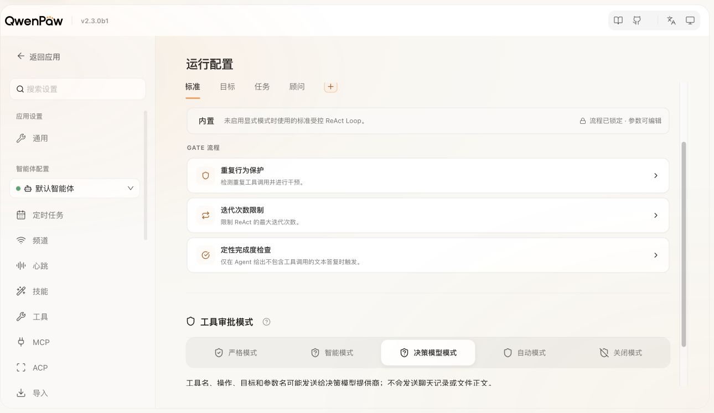

3. **Enable context compaction.** Enable context compaction under **Runtime Configuration → Context Capacity**, then turn on **Decision Model Compaction**.

   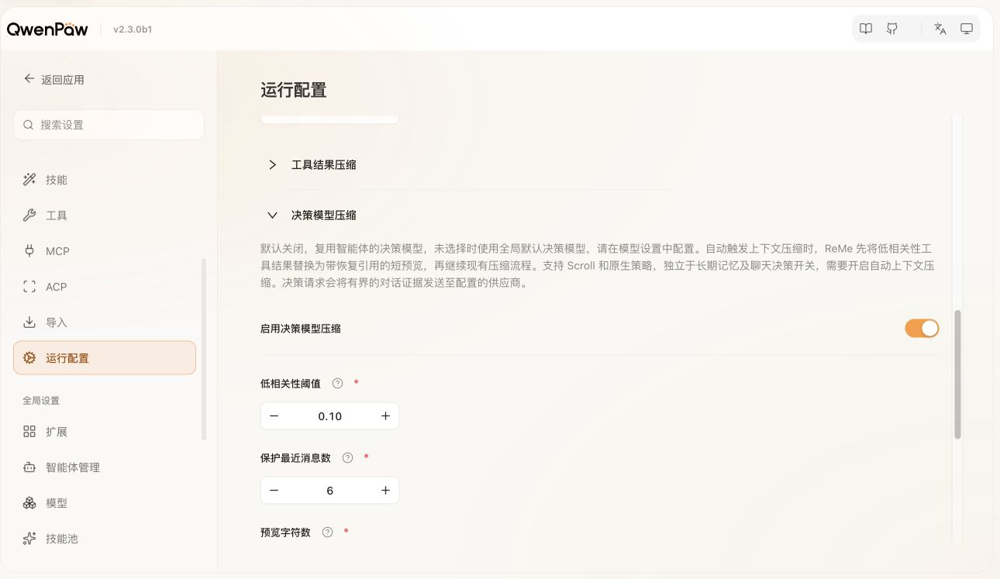

[Watch the QwenPaw settlement audit recording](https://decisionplayground.agentscope.io/piccolo.html#qwenpaw-showcase). Piccolo automatically approves two Bash read operations, then declines automatic approval after identifying the destructive risk of overwriting a report. The operator selects Deny. The calculated settlement is ¥188, while the original report retains ¥276.

The [three-step setup screenshots](../assets/qwenpaw/README.md) can be reused on the website or in future articles. Starting a model and enabling features are separate steps. The built-in llama.cpp runtime manages only one running model; conversations can use other providers. Local decisions reduce additional remote requests and process tool metadata and history excerpts on the local machine. Data flows for the main conversation model and other tools depend on their own configurations.

## 05 Evaluation for Real Workflows

### HarnessJevBench

[HarnessJevBench](https://github.com/agentscope-ai/HarnessJevBench) covers Harness control responsibilities such as tool execution, resource scheduling, context management, permission boundaries, completion acceptance, and error recovery. Tasks provide explicit states, evidence, and execution rules to test whether the model checks constraints comprehensively.

Evaluation measures both **decision accuracy** and **total variation distance (TV) between probability distributions**. Piccolo-27B achieves **84.41%** accuracy on the Hard subset shown in the table. See [evaluation records](../evaluation/README.md) for full results.

### DataJevBench

[View English queries and judgment records](https://decisionplayground.agentscope.io/piccolo.html#datajev-showcase). Piccolo-4B-Q4_K_M reads 24 complete samples and judges whether the supplied material is sufficient to answer each question.

[DataJevBench](https://github.com/datajuicer/DataJevBench) targets data workflows, covering data admission, processing-plan selection, artifact quality, analysis readiness, artifact verification and disclosure, and task execution control. v0.5 contains **500 tasks**: 480 multiple-choice questions and 20 ordinal-scoring questions in Chinese and English.

Piccolo-27B achieves **82.60% overall accuracy (413/500)**, with **92.50%** on data artifact quality evaluation and **82.00%** on information sufficiency judgments. The benchmark combines accuracy, ECE, and Brier scores to analyze correctness and probability quality across tasks.

## 06 Next Steps

We want decision models to provide a shared foundation connecting models, execution, and feedback. Next, we will expand task coverage and improve real-workflow evaluations for review and compaction.

Try the [Decision website](https://decisionplayground.agentscope.io/), explore the implementation on [GitHub](https://github.com/agentscope-ai/Piccolo), and download models from [Hugging Face](https://huggingface.co/agentscope-ai/Piccolo-27B).
